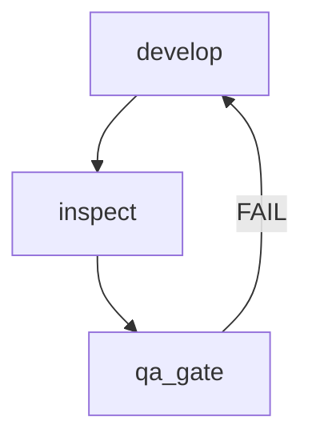

# Modificar um workflow

## Objetivo

Alterar um workflow existente mantendo a lógica de orquestração: sequência contínua, agentes válidos, artefatos encadeados e transições coerentes, com análise de impacto, backup, simulação, diff aprovado e validação.

## Quando usar

- Etapa nova, etapa removida, troca de agente ou de task, nova condição ou retorno em caso de falha.
- Correção de achado do `*validate-framework` num workflow.
- Não use para criar workflow: `*create-workflow`.

## Pré-condições

- [ ] Workflow existe no alvo: core em `.sia-core/workflows/{id}.yaml`; squad ou hybrid em `squads/{nome}/workflows/{id}.yaml`, com `squad.yaml` válido
- [ ] Mudança descrita (intenção ou alterações)
- [ ] Mudança num workflow do framework que altera o processo do SIA: story do `@pm`

## Modos

| Modo | Interação | Nesta task |
|------|-----------|------------|
| YOLO | 1 pergunta: a aprovação do diff | Analisa, simula e prepara tudo sem checkpoints intermediários |
| Interativo (padrão) | checkpoints nos passos 2, 4 e 10 | Confirma impacto, ponto de inserção e diff |
| Pre-Flight | todas as perguntas antes | Esclarece intenção, etapas, agentes e artefatos; depois executa |

A aprovação explícita do diff (passo 10) vale em todos os modos.

## Passos

### 1. Carregar e analisar

Leia o workflow e registre: metadados (id, name, description, type, project_types), `sequence` (etapas, fases, agentes e chapéus, tasks, `creates`, `requires`, `condition`, `on_failure`, `success_criteria`), `flow_diagram`, `decision_guidance` e `handoff_prompts`.

### 2. Analisar o impacto

```bash
grep -rn "{id}" .sia-core squads
```

| Consumidor | Onde |
|------------|------|
| Cadeias | entrada do workflow em `data/workflow-chains.yaml` |
| Skills | skills que conduzem o workflow (`.sia-core/skills/*/SKILL.md`) |
| Tasks | tasks que executam ou citam o workflow (ex.: `run-workflow.md`, `execute-epic.md`, `qa-loop.md`) |
| Agentes | `dependencies.workflows` |
| CLI | fases e ids do `story-development-cycle` conferidos por `sia sdc` |
| Documentação | tabela de workflows do `user-guide.md` |

Registre também quais agentes o workflow orquestra, que artefatos produz e consome e com que outros workflows se integra.

**Ponto de elicitação (com consumidores):** {n} pontos de uso. 1. Seguir 2. Reduzir a mudança 3. Cancelar

### 3. Fazer o backup

Copie o arquivo para `.sia/backups/{AAAAMMDD-HHmmss}/{caminho do arquivo}`. Falha: `BACKUP_FAILED`; pare sem alterar nada.

### 4. Traduzir a intenção em mudanças

Intenção de alto nível: analise o fluxo atual e defina o ponto de inserção, o agente (e o chapéu), a task, os artefatos e as transições de entrada e de saída da etapa. Alterações específicas: valide a estrutura e a coerência da sequência.

**Ponto de elicitação:** mostre o ponto de inserção e a etapa proposta. 1. Seguir 2. Ajustar

### 5. Validar a sequência

- Fases contínuas, sem lacunas (renumere depois de inserir ou remover)
- `requires` só cita etapas anteriores, sem ciclos
- Agentes válidos: os 5 do SIA e, em squad ou hybrid, os do squad (squad primeiro; o mesmo id nos dois contextos é ambíguo)
- Tasks existem e `hat` é válido para pm e dev
- Exclusividades do Artigo II (push, PR, release e deploy só com `devops`) e transições de status da seção 6 do guia
- Toda etapa recebe de uma etapa anterior o artefato que precisa
- `condition`, quando houver, é um identificador descritivo

### 6. Atualizar o diagrama

Atualize o `flow_diagram` com as etapas e transições novas: declaração `flowchart TD` (ou `graph`) e colchetes balanceados.



### 7. Atualizar handoffs e orientação

Acrescente ou ajuste `handoff_prompts` para cada troca de agente nova e revise `decision_guidance` se o uso do workflow mudou.

### 8. Gerar o diff

```diff
@@ Workflow: content-production @@
@@ sequence @@
   - step: write_article
     id: write
+  - step: review_article
+    id: review
+    phase: 3
+    agent: validator
+    task: inspect.md
+    requires: [write]
   - step: publish_article
-    requires: [write]
+    phase: 4
+    requires: [review]
@@ handoff_prompts @@
+  write_to_review: "Artigo pronto. Próximo: @validator *revisar-feature"
```

### 9. Simular

Percorra a sequência etapa a etapa e confirme agente, task e artefato de cada uma:

```text
1. pauta (pauteiro) → pauta.md ✓
2. write (redator) → artigo.md ✓
3. review (validator) → relatório de inspeção ✓
4. publish (redator) → artigo publicado ✓
Transições válidas ✓ | Agentes existem ✓ | Sem ciclos ✓
```

### 10. Aprovar

**Ponto de elicitação:** mostre o resumo, o diff, o diagrama atualizado, a simulação e o impacto (etapas novas, carga de cada agente, artefatos novos, efeito no tempo do fluxo).

1. Aplicar
2. Ajustar
3. Cancelar

### 11. Aplicar

Grave o workflow de uma vez. Atualize os consumidores do passo 2: cadeia em `data/workflow-chains.yaml`, skills, tasks que citam as etapas e documentação. Commit e push seguem o fluxo normal do projeto (push só com o `@devops`).

### 12. Validar e projetar

```bash
sia validate                    # ou sia validate --squad {nome}
sia sync
# sem sia no PATH: node .sia-core/cli/sia.js {comando}
```

### 13. Desfazer, se preciso

Validação com erro sem correção simples, ou pedido do usuário: restaure o backup, desfaça as mudanças nos consumidores, rode `sia validate` e `sia sync` e registre o motivo.

## Saída

```text
=== Modificação de workflow ===
Workflow: content-production | Data: 2026-10-16T14:30:00-03:00
Backup: .sia/backups/20261016-143000/squads/conteudo/workflows/content-production.yaml

Estrutura: 4 etapas (antes: 3) | Agentes: pauteiro, redator, validator
Mudanças:
  ✓ etapa nova: review (fase 3)
  ✓ 1 fase renumerada
  ✓ handoff write_to_review
  ✓ diagrama atualizado
Validação: ✓ YAML válido | ✓ sequência contínua | ✓ agentes existem | ✓ sem ciclos
Simulação: ✓ todas as etapas executáveis | ✓ artefatos encadeados
Impacto: +1 etapa para o validator; artefato novo: relatório de inspeção
Para desfazer: restaure o backup e rode sia validate e sia sync
```

## Critérios de conclusão

- [ ] Impacto analisado e consumidores atualizados
- [ ] Backup feito antes da mudança
- [ ] Sequência contínua, sem ciclos, com agentes e tasks válidos e handoffs para toda troca de agente
- [ ] Diagrama atualizado e simulação aprovada
- [ ] Diff aprovado explicitamente
- [ ] `sia validate` sem erros e `sia sync` executado

## Tratamento de erros

| Situação | Ação |
|----------|------|
| Workflow não encontrado | Verifique id, alvo e caminho; liste os workflows do contexto |
| YAML inválido | Mostre a linha e a correção |
| Lacuna na sequência de fases | Destaque as fases faltantes e renumere |
| Agente inexistente | Liste os agentes indisponíveis; sugira `*create-agent` |
| Ciclo em `requires` | Mostre o ciclo e onde quebrá-lo |
| Diagrama Mermaid inválido | Corrija a declaração ou os colchetes |
| Fases do `story-development-cycle` alteradas | Pare; mudança só coordenada com a CLI (`sia sdc`), numa story do `@pm` |

## Handoff

Próximo passo: `@squad-creator *validate-framework` e `*sync-ide` (se já não rodaram no passo 12).
