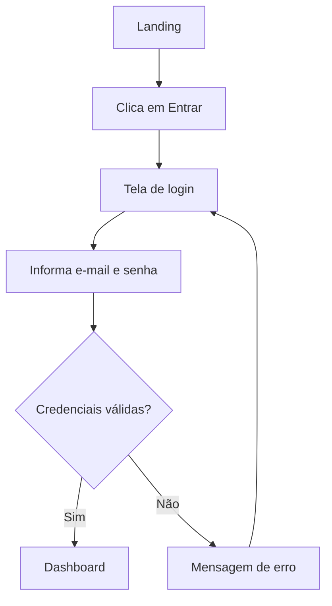

# Criar wireframes e fluxos de interação

## Objetivo

Traduzir as necessidades dos usuários em wireframes, fluxos de interação e inventário de componentes, com as decisões de design anotadas e um pacote de handoff pronto para a especificação e a implementação.

## Quando usar

- Depois de `*ux-research` (ou com personas já conhecidas) e antes de `*create-front-end-spec` ou `*ux-ai-prompt`.
- Para explorar alternativas de layout (baixa fidelidade), revisar com stakeholders ou testar usabilidade (média) e entregar para implementação (alta).
- Para inventariar os componentes de telas existentes antes de montar o design system.

## Modos de execução

| Modo | Comportamento nesta task |
|------|--------------------------|
| YOLO | Assume baixa fidelidade (ASCII), deriva telas e conteúdo do PRD ou da spec e registra as premissas em `annotations.md`. |
| Interativo (padrão) | Checkpoints nos passos 1, 4 e 8. |
| Pre-Flight | Faz as perguntas dos passos 1 e 2 de uma vez e desenha sem novas perguntas. |

## Pré-condições

- [ ] Telas ou fluxo definidos (argumento do comando ou elicitação).
- [ ] Contexto do usuário disponível: `docs/ux/research/`, personas do PRD ou descrição do usuário.

## Níveis de fidelidade

| Nível | Quando usar | Ferramentas | Tempo | Detalhe |
|-------|-------------|-------------|-------|---------|
| Baixa | exploração inicial, iteração rápida | ASCII, papel, quadro | 30 min a 2 h | caixas e rótulos, sem estilo |
| Média | revisão com stakeholders, teste de usabilidade | Figma, Sketch, Balsamiq | 4 a 8 h | layout, hierarquia, parte do conteúdo |
| Alta | handoff para desenvolvimento, aprovação final | Figma, Adobe XD, Sketch | 1 a 3 dias | design visual, conteúdo real, interações |

O agente desenha a baixa fidelidade em ASCII. Na média e na alta, descreve layout, hierarquia e estados e referencia os arquivos da ferramenta de design por link.

## Passos

### 1. Definir o escopo

**Ponto de elicitação:**

```text
Qual fidelidade?
1. Baixa: esboços rápidos para explorar
2. Média: layout e estrutura
3. Alta: design visual pronto para desenvolvimento

Quais telas? (ex.: "Login, Dashboard, Perfil")
Qual é o caso de uso principal? (ex.: "usuário agenda um serviço")
```

Defina o `{slug}` (kebab-case, sem acentos) a partir do fluxo.

### 2. Revisar a pesquisa

Traga de `docs/ux/research/` (ou do PRD) as personas, os objetivos, as dores, os comportamentos e as restrições:

```text
Desenhando para: {persona}
Objetivo: {objetivo do usuário}
Dor: {dor relevante}
Restrição: {técnica ou de negócio}
```

### 3. Montar a arquitetura de informação

Liste o conteúdo de cada tela: títulos, navegação, campos de formulário, botões e CTAs, imagens e mídia, exibição de dados e textos de ajuda.

```text
Tela: Dashboard
- Título da página e saudação ao usuário
- Menu de navegação (4 itens)
- Indicadores rápidos (3 métricas)
- Atividade recente (5 itens) com link "Ver tudo"
- CTA primário e link secundário
```

### 4. Desenhar os wireframes

Baixa fidelidade, em ASCII:

```text
+--------------------------------------------------------+
| [Logo]                  [Nav1] [Nav2] [Nav3] [Perfil]  |
+--------------------------------------------------------+
| Dashboard                                              |
| +--------------+  +--------------+  +--------------+   |
| | Métrica 1    |  | Métrica 2    |  | Métrica 3    |   |
| | [Número]     |  | [Número]     |  | [Número]     |   |
| +--------------+  +--------------+  +--------------+   |
| Atividade recente                         [Ver tudo]   |
| [ ] Item 1 - descrição                    [Ação]       |
| [ ] Item 2 - descrição                    [Ação]       |
| [+ Nova ação]                                          |
+--------------------------------------------------------+
| Links do rodapé | Copyright | Privacidade              |
+--------------------------------------------------------+
```

Em média e alta fidelidade, cubra em cada tela: navegação (global e contextual), título e breadcrumbs, áreas de conteúdo (principal, secundária, lateral), formulários (rótulos, campos, validação, botões), exibição de dados (tabelas, cards, listas), mídia, CTAs e os estados de **carregamento**, **vazio** e **erro**.

Boas práticas:

- **Hierarquia visual:** maior = mais importante; negrito = ação ou ênfase; cor = status ou categoria; proximidade = itens relacionados.
- **Consistência:** os mesmos componentes, espaçamentos, navegação e padrões de interação em todas as telas.
- **Mobile-first:** comece pela menor tela e evolua para as maiores; alvos de toque de 44×44 px (mínimo WCAG 2.2 AA: 24×24 px); nada que dependa só de hover.
- **Acessibilidade:** contraste ≥ 4.5:1, foco visível, ordem de tabulação lógica, texto alternativo em imagens, rótulos e mensagens de erro em formulários (`wcag-compliance-guide.md`).
- Comece em baixa fidelidade e suba aos poucos; compartilhe cedo para receber feedback.

**Ponto de elicitação:** apresente os wireframes e peça: 1. aprovar, 2. ajustar uma tela, 3. explorar uma alternativa de layout.

### 5. Documentar os fluxos de interação

Desenhe cada fluxo com caminho de sucesso e caminho de erro (com nova tentativa). Use Mermaid:



### 6. Anotar as decisões

Anote cada elemento relevante por tipo: funcionalidade ("abre um modal"), conteúdo ("primeiro nome do perfil"), estado ("desabilitado se o formulário estiver incompleto"), regra de negócio ("só para plano premium"), acessibilidade ("foco preso no modal aberto"), desempenho ("carregar imagens abaixo da dobra sob demanda") e analytics.

```text
[Botão: Salvar alterações]
- Desabilitado: formulário com erro de validação
- Carregando: spinner durante a chamada à API
- Sucesso: ícone de confirmação + "Salvo!"
- Erro: ícone de erro + mensagem
- Acessibilidade: nome acessível "Salvar alterações no perfil"
- Analytics: evento "profile_save_clicked"
```

### 7. Inventariar os componentes

Quebre as telas em componentes pelo Atomic Design (`atomic-design-principles.md`) e conte as ocorrências. Procure no código o que já existe (REUSE > ADAPT > CREATE) e marque cada item como existente, a adaptar ou novo.

```markdown
## Inventário de componentes

### Átomos
- Button (primary, secondary, destructive, ghost): existente
- Input (text, email, password, number, search): a adaptar
- Label, Icon, Badge, Avatar, Divider

### Moléculas
- FormField (Label + Input + texto de ajuda + erro): novo
- SearchBar (Input + Icon + Button), StatDisplay (rótulo + número + tendência)
- EmptyState (ícone + título + descrição + CTA), Toast (ícone + mensagem + fechar)

### Organismos
- Header (Logo + navegação + busca + perfil)
- DataTable (cabeçalhos + linhas + paginação), Modal (overlay + cabeçalho + corpo + rodapé)
```

### 8. Preparar o handoff

Monte o `handoff-package.md` com: wireframes, fluxos, inventário de componentes, anotações, assets (ícones, logos) e medidas.

```text
Espaçamento (base 4 px): xs 4 | sm 8 | md 16 | lg 24 | xl 32 | 2xl 48 | 3xl 64
Breakpoints: mobile < 640 px | tablet 640 a 1024 px | desktop > 1024 px
```

Registre o comportamento responsivo de cada tela por breakpoint. Se o design system já existir, use a escala e os breakpoints dos tokens em vez desta referência.

**Ponto de elicitação:** apresente o pacote e peça: 1. aprovar, 2. ajustar telas, 3. subir a fidelidade.

## Saída

Em `docs/ux/wireframes/{slug}/`:

| Arquivo | Conteúdo | Obrigatório |
|---------|----------|-------------|
| `screens/` | um arquivo por tela (`{tela}.md` em ASCII) ou exportações PNG/PDF | sim |
| `flows.md` | fluxos de interação | sim |
| `component-inventory.md` | inventário por nível atômico | sim |
| `annotations.md` | anotações, decisões e premissas | sim |
| `handoff-package.md` | guia de handoff | sim |
| `measurements.md`, `responsive-notes.md`, `assets/` | medidas, variações por breakpoint, ícones e imagens | quando aplicável |

## Critérios de conclusão

- [ ] Wireframes de todas as telas pedidas, na fidelidade escolhida.
- [ ] Estados de carregamento, vazio e erro desenhados para telas com dados.
- [ ] Fluxos com caminho de sucesso e de erro.
- [ ] Inventário de componentes completo, por nível atômico, com o que já existe marcado.
- [ ] Anotações explicam as decisões de design.
- [ ] Espaçamento, medidas e comportamento responsivo definidos.
- [ ] Pacote de handoff gravado em `docs/ux/wireframes/{slug}/`.

## Tratamento de erros

| Situação | Ação |
|----------|------|
| Sem pesquisa nem personas | Pergunte público e objetivo, registre como premissa em `annotations.md` e sugira `*ux-research` |
| Detalhe demais cedo | Volte à baixa fidelidade e valide a estrutura primeiro |
| Tela sem estados de borda | Não conclua sem carregamento, vazio e erro |
| Componente novo parecido com um existente | Reutilize ou adapte o existente e registre no inventário |
| Telas sem versão mobile | Desenhe a versão mobile antes de seguir |
| Wireframes já existem para o `{slug}` | Pergunte se atualiza ou cria nova versão |

## Handoff

Próximo passo: `@dev *create-front-end-spec`, com os wireframes e o inventário como base. Para gerar a interface em ferramentas de IA (v0, Lovable), `@dev *ux-ai-prompt`. Componentes novos do inventário: `@dev *ux-build-component {componente}`, na ordem átomos → moléculas → organismos.
