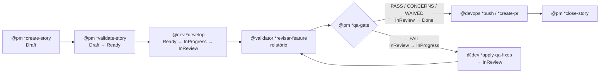

# Arquitetura do SIA

> Documento para quem mantém o framework. Registra o que o SIA é, as decisões de desenho e o que mudou em relação ao AIOX.
> Guia do usuário: `.sia-core/user-guide.md` · Contrato de formato: `.sia-core/data/sia-authoring-guide.md` · CLI: `docs/sia/cli.md`

---

## 1. Visão geral

O SIA (Sling Inteligência Artificial) é um framework de desenvolvimento orientado por agentes de IA. O trabalho é organizado em stories, o processo é executado por tasks e a responsabilidade é dividida entre **5 agentes**:

| Agente | Nome | Responde por |
|--------|------|--------------|
| `@pm` | Mira 🎯 | Produto, pesquisa, PRD, epics, stories, backlog e o veredito de qualidade |
| `@dev` | Davi 🛠️ | Implementação, arquitetura, banco de dados (Supabase) e UX/UI |
| `@devops` | Lance 🚀 | Push, PR, release, CI/CD, deploy na Vercel e conexão de MCPs |
| `@validator` | Vera 🔍 | Inspeção técnica independente da entrega, com evidência |
| `@squad-creator` | Elo 🔗 | Squads e construção do próprio framework (agentes, tasks, workflows) |

O SIA deriva do Synkra AIOX 5.4.1. Mantém o rigor de processo (stories, gates, autoridade exclusiva, sem invenção) e reduz o número de agentes, o runtime e as integrações.

---

## 2. Decisões de desenho

### D1. Cinco agentes com chapéus

O AIOX tem 12 agentes. O SIA consolida em 5. Os agentes consolidados vestem **chapéus**: cada comando declara o chapéu, e o chapéu define o mindset e o checklist aplicado.

| Agente do SIA | Absorve do AIOX | Chapéus |
|---------------|-----------------|---------|
| `@pm` | pm, po, sm, qa, analyst + orquestração do aiox-master | product, analyst, scrum, owner, quality |
| `@dev` | dev, architect, data-engineer, ux-design-expert | dev, architect, data, ux |
| `@devops` | devops | (único) |
| `@validator` | validator (kit separado no AIOX) | (único) |
| `@squad-creator` | squad-creator + construção de framework do aiox-master | (único) |

**Risco aceito:** o mesmo agente cria e valida a story, ou escreve e critica a spec.
**Mitigação:** regra de separação de chapéus (guia de autoria, 4.2). O agente declara o chapéu ativo, aplica o checklist completo sem leniência, e o veredito de qualidade depende da inspeção independente do `@validator`.

### D2. Qualidade: o `@pm` decide, o `@validator` inspeciona

- O `@validator` faz a inspeção técnica em 7 lentes (gaps, falhas, lógica, regressão, segurança, arquitetura, código morto). Ele grava um relatório com veredito `aprovado`, `aprovado com ressalvas` ou `reprovado` e nunca muda status.
- O `@pm` [Qualidade] usa esse relatório, os critérios de aceite e os testes para dar o veredito do QA gate (`PASS`, `CONCERNS`, `FAIL`, `WAIVED`) e mover a story.
- Com `quality.inspection.requiredBeforeGate: true` no core-config, não existe `PASS` sem relatório de inspeção.

### D3. Idioma

Conteúdo em português do Brasil (personas, tasks, templates, checklists, docs). Identificadores em inglês (arquivos, chaves YAML, comandos, status). Os comandos e vereditos do `@validator` continuam em português, porque o time já os usa.

### D4. Runtime enxuto

O processo vive em Markdown/YAML. JavaScript existe só em:

- **CLI `sia`** (`.sia-core/cli/`): validação, diagnóstico, sincronização das IDEs, estado do ciclo da story, facilitador de MCP, agente ativo e listagem de squads.
- **Dois hooks** (`.sia-core/hooks/`): autoridade de push/PR/release/deploy de produção, e registro do agente ativo a partir do prompt.

A CLI não tem dependências instaladas: o `js-yaml` vai embutido em `cli/vendor/`. Fica de fora do SIA todo o runtime do AIOX que não é essencial: SYNAPSE, code intelligence, graph dashboard, monitor, métricas, IDS, Pro, orquestrador Bob, build autônomo e pipeline de ativação em JS (cerca de 590 arquivos JS no AIOX).

### D5. Fonte única e projeções

- Tudo nasce em `.sia-core/` (e em `squads/`). As pastas das IDEs são projeções geradas por `sia sync`.
- As projeções **apontam** para `.sia-core/agents/{id}.md` em vez de copiar a definição do agente. Isso elimina a divergência entre cópias, que no AIOX existia em `.codex/agents`, `.gemini/rules` e `.claude/skills`.

| IDE | Projeção |
|-----|----------|
| Claude Code | `.claude/skills/sia-*`, `.claude/commands/SIA/agents/*`, `.claude/agents/sia-*` (subagentes), `.claude/rules/sia-*`, hooks em `.claude/settings.json`, `CLAUDE.md` |
| Codex (ChatGPT) | `AGENTS.md` (com as regras embutidas), `.codex/skills/sia-*` |
| Gemini CLI | `.gemini/commands/sia-*.toml`, `GEMINI.md`, hooks em `.gemini/settings.json` (se suportado) |
| Grok Build | `.grok/skills/sia-*`, `.grok/agents/sia-*`, `.grok/hooks/sia-*.json`, `.grok/rules/sia-core.md` |

Cada pasta de IDE tem um `sia-managed.json` com os arquivos gerados e seus hashes. `sia sync --check` aponta divergência, e arquivos não gerenciados nunca são tocados.

### D6. Integrações

| Mantidas ou novas | Removidas |
|-------------------|-----------|
| GitHub (push, PR, release, CI) | ClickUp |
| Supabase (chapéu Dados do `@dev`) | CodeRabbit (substituído pela inspeção do `@validator`) |
| Vercel (setup e deploy pelo `@devops`) | Docker MCP gateway e gestão genérica de MCP |
| Facilitador de MCP do Supabase e da Vercel nas 4 IDEs (`sia mcp setup`) | SYNAPSE, code-intel, IDS, Pro |

### D7. Ciclo da story com fase de inspeção



A CLI acompanha o ciclo com as fases `validate → develop → inspect → review → apply_qa_fixes → close`. O loop de QA tem um teto de iterações (`quality.qaLoop.maxIterations`, padrão 5), e um circuit breaker para o ciclo e escala quando o teto é atingido.

### D8. Agente ativo registrado por hook

No AIOX, o hook de push identificava o agente ativo por um arquivo-ponte que, no Claude Code, ninguém escrevia. Na prática, o push só passava com um prefixo manual.

No SIA, o hook `track-active-agent` lê o prompt do usuário e registra o agente em `.sia/active-agent.json` quando há uma ativação (`/sia-devops`, `/SIA:agents:devops`, `@devops`). O hook de autoridade usa esse registro, que vale por 8 horas. Assim a regra fica determinística e controlada pelo usuário.

Onde a IDE não suporta hooks de prompt, existe o fallback `sia agent use {id}`.

### D9. Sem instalador nesta fase

O instalador vem depois da validação. Para validar sem instalador, `sia sync --target {pasta} --link-core` gera as projeções num projeto de teste e cria um link para o `.sia-core` deste repositório.

---

## 3. Estrutura

```text
sia-framework/                  # repositório-fonte do SIA
├── .sia-core/                  # o framework (o que o instalador vai copiar)
│   ├── constitution.md
│   ├── core-config.yaml
│   ├── user-guide.md
│   ├── agents/                 # 5 agentes + memória por agente
│   ├── tasks/                  # ~94 tasks
│   ├── templates/              # documentos, SQL, CI, squad, serviço
│   ├── checklists/
│   ├── workflows/              # 7 workflows
│   ├── data/                   # guia de autoria, KB, padrões, MCP, presets
│   ├── rules/                  # regras projetadas nas IDEs
│   ├── skills/                 # skills de workflow (SDC)
│   ├── hooks/                  # 2 hooks de governança
│   ├── schemas/                # squad-schema.json
│   └── cli/                    # CLI `sia` (sem dependências instaladas)
└── docs/sia/                   # documentação de manutenção
    ├── architecture.md         # este arquivo
    ├── cli.md                  # referência da CLI
    └── porting-map.yaml        # rastreabilidade AIOX → SIA
```

No repositório-fonte, as projeções (`.claude/`, `.codex/`, `.gemini/`, `.grok/`, `CLAUDE.md`, `AGENTS.md`, `GEMINI.md`) ficam fora do git, porque são geradas. Nos projetos que usam o SIA, elas são versionadas junto com o `.sia-core/`.

---

## 4. AIOX → SIA em números

| Item | AIOX 5.4.1 | SIA 1.0 |
|------|-----------|---------|
| Agentes | 12 | 5 |
| Tasks | 219 | ~94 (fundidas e condensadas, sem boilerplate) |
| Workflows | 15 | 7 |
| Arquivos JS | ~590 | CLI + 2 hooks |
| IDEs | 8 | 4 (Claude Code, Codex, Gemini, Grok) |
| Dependências npm | 15 | 0 (js-yaml embutido) |

A origem de cada artefato está em `docs/sia/porting-map.yaml`, inclusive o que foi removido e por quê.

---

## 5. Pontos de extensão

- **Novo agente ou task do framework:** `@squad-creator *create-agent` / `*create-task`, seguindo o guia de autoria, depois `sia validate` e `sia sync`.
- **Domínio novo (vendas, conteúdo, atendimento):** um squad em `squads/{nome}/` (`*design-squad`, `*create-squad`).
- **Nova IDE:** um gerador novo em `.sia-core/cli/projections/` e uma entrada em `ide.targets`.
- **Novo servidor MCP:** uma entrada em `.sia-core/data/mcp-servers.yaml`; o `sia mcp setup` já sabe gravar JSON e TOML.

---

## 6. Próximos passos

1. Validar o framework num projeto-sandbox nas 4 IDEs (`sia sync --target`).
2. Ajustar tasks e agentes com base no uso real.
3. Construir o instalador: copiar `.sia-core/`, rodar `sia sync` para as IDEs escolhidas e mesclar arquivos existentes.
4. Remover o AIOX de referência deste repositório.
